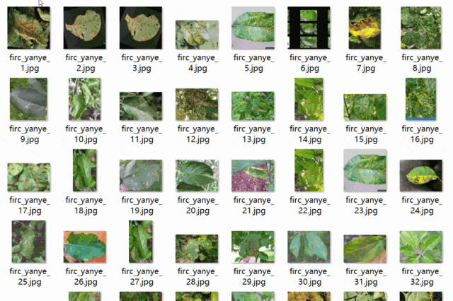
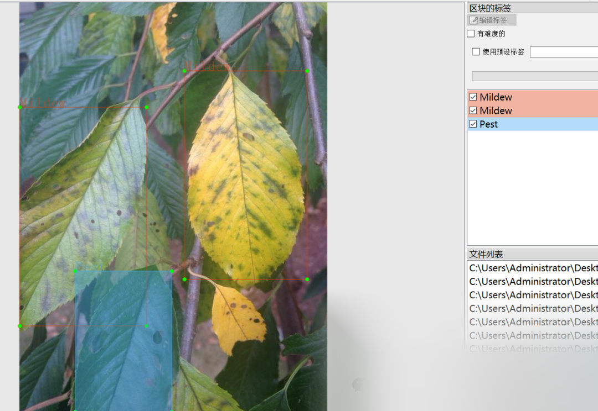

# [Dataset] [Object Detection] VOC+YOLO format, 612 images in 3 categories for tobacco disease detection

Dataset format: Pascal VOC format + YOLO format (txt files without split paths, only containing jpg images and corresponding VOC format xml files and yolo format txt files)
Number of images (number of jpg files): 612
Number of annotations (number of xml files): 612
Number of annotations (number of txt files): 612
Number of annotation categories: 3
Annotation category names: ["Healthy", "Mildew", "Pest"]
Number of bounding boxes for each category:
Healthy bounding box count = 2645
Mildew bounding box count = 630
Pest bounding box count = 1879
Total bounding box count: 5154
Labeling tool used: labelImg
Annotation rules: Draw a rectangle around the category
Important note: Mildew represents leaf mold, Pest indicates that the leaves have been eaten by insects, not detecting insects on the leaves but eaten leaves.
Special declaration: This dataset does not guarantee the accuracy or weights of the trained models or weight files, only accurate and reasonable annotations are provided.

Image Preview:

Annotation example:

## Payment

Here is a pay link on Stripe ( https://buy.stripe.com/3cs8yP7sY87d0vu9AB ). Please contact me lonlonago@foxmail.com after funding $89, and I will send you a complete data files , thank you!

